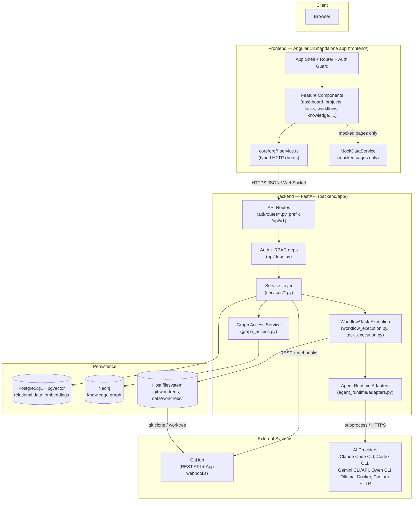
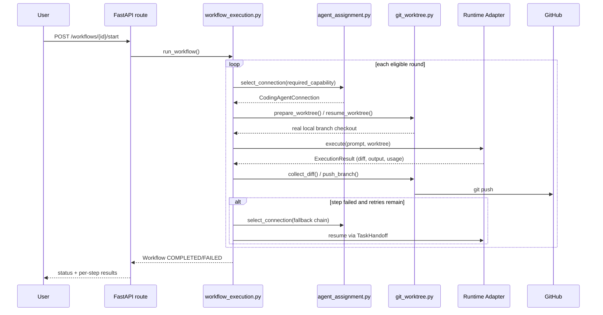

# Software Factory

An AI-powered software engineering platform that coordinates real coding-agent execution — not
simulated output — across multiple AI providers, against real Git repositories, with a shared
knowledge graph, versioned workflows, and governance controls on top.

This README is the entry point. Deep-dive documentation lives in [`docs/architecture/`](docs/architecture/):

- [System Architecture](docs/architecture/system-architecture.md) — full platform topology, every subsystem
- [Component Architecture](docs/architecture/component-architecture.md) — per-component responsibilities, internals, status
- [Data Architecture](docs/architecture/data-architecture.md) — relational schema, graph schema, storage boundaries
- [Security Architecture](docs/architecture/security-architecture.md) — auth, isolation, credential handling, sandboxing
- [Workflows](docs/architecture/workflows.md) — end-to-end sequence diagrams, from task creation to merged code

Day-to-day engineering ground truth (what's actually done vs. planned, by phase) lives in
[`IMPLEMENTATION_STATE.md`](IMPLEMENTATION_STATE.md) — treat it as more current than this README for
fine-grained status questions.

## Table of Contents

- [What Software Factory Is](#what-software-factory-is)
- [Key Features](#key-features)
- [High-Level Architecture](#high-level-architecture)
- [Agent Orchestration](#agent-orchestration)
- [Knowledge Graph & Repository Intelligence](#knowledge-graph--repository-intelligence)
- [Prompt Registry (Frontend Mock — Not Yet Backend-Wired)](#prompt-registry-frontend-mock--not-yet-backend-wired)
- [Coding Agent Execution & Sandboxing](#coding-agent-execution--sandboxing)
- [Technology Stack](#technology-stack)
- [Installation & Setup](#installation--setup)
- [Project Structure](#project-structure)
- [API Reference](#api-reference)
- [Development Roadmap](#development-roadmap)
- [Contributing](#contributing)

## What Software Factory Is

Software Factory is a FastAPI + Angular platform where a human describes a unit of work — a task or
a multi-step workflow — and a real coding-agent CLI or API (Claude Code, Codex, Gemini CLI, Qwen,
Ollama, a Docker sandbox, or a custom HTTP adapter) executes it against a real git worktree checked
out from a connected GitHub repository. Results — diffs, test runs, PRs — are genuine outputs of that
execution, never fabricated or templated. This "never hard-code a successful result" constraint shows
up throughout the codebase and its tests: when a runtime isn't actually connected, a task fails
honestly rather than reporting fake success.

**Problem it solves:** most "AI coding" tools are either a single chat session with no durable state,
or a CI-adjacent bot with no real orchestration. Software Factory sits in between — a system of
record for tasks and workflows, with real knowledge about a project's codebase (via a Neo4j knowledge
graph), multi-provider agent routing with fallback, and governance (approvals, audit log, safety
scanning) over what actually gets executed and merged.

**Core architectural principles** (see [`DECISION_REGISTER.md`](DECISION_REGISTER.md) for the full
rationale behind each):

- Multi-provider by design: a common `CodingAgentRuntimeAdapter` interface with provider-specific
  adapters, not one hard-coded LLM vendor.
- Real execution over simulation: every task result, diff, and test run is the genuine output of a
  real subprocess/API call against a real git worktree.
- Shared Neo4j knowledge graph with mandatory per-project authorization via a dedicated
  [Graph Access Service](docs/architecture/component-architecture.md#graph-access-service) — no route
  or background job queries the graph with an unscoped project id.
- Honest capability reporting: partially-implemented or mocked frontend features are documented as
  such in this README rather than described as complete.

**Intended users:** engineering teams who want an internal platform for delegating well-scoped coding
tasks to AI agents with real git/PR integration, plus the audit trail and approval gates a regulated
or security-conscious organization needs.

## Key Features

### Implemented and backend-verified

| Category | Capability |
|---|---|
| Agent Orchestration | Dependency-aware workflow scheduling, real parallel step execution, capability-based agent assignment, policy-controlled provider fallback chains ([`workflow_execution.py`](backend/app/services/workflow_execution.py)) |
| Multi-Provider Agents | 7 runtime adapters behind one interface: Claude Code, Codex, Gemini CLI, Qwen, Ollama, Docker Sandbox, Custom HTTP ([`agent_runtime/adapters.py`](backend/app/services/agent_runtime/adapters.py)) |
| Task & Workflow Execution | Real task lifecycle (create → start → running → completed/failed/cancelled), multi-turn follow-up conversations, resumable agent handoff mid-task ([`task_execution.py`](backend/app/services/task_execution.py), [`handoff.py`](backend/app/services/handoff.py)) |
| Git Integration | GitHub App installation flow, repository connection, branch listing/creation, PR creation, webhook ingestion ([`git_integration.py`](backend/app/api/routes/git_integration.py)) |
| Knowledge Graph | Neo4j-backed repository code graph (files, imports, dependency/test-mapping edges) and project entity graph, incremental + full re-index ([`knowledge_graph.py`](backend/app/services/knowledge_graph.py)) |
| RAG / Document Knowledge | Markdown/text ingestion, chunking, Ollama embeddings, pgvector cosine retrieval, injected into task prompts ([`document_retrieval.py`](backend/app/services/document_retrieval.py)) |
| Testing & Validation | Real pytest/npm test execution against the task's actual worktree, persisted results ([`test_runner.py`](backend/app/services/test_runner.py)) |
| Observability | Per-attempt execution spans (timed phases), token/duration usage where the provider reports it, notifications (WebSocket + poll), organization audit log ([`orchestration.py`](backend/app/models/orchestration.py), [`notifications.py`](backend/app/services/notifications.py), [`audit.py`](backend/app/services/audit.py)) |
| Security & Governance | JWT auth + refresh sessions, RBAC (org/project roles), rate-limited auth, approval gate on task outcomes, heuristic prompt-injection and output-secret scanning ([`safety.py`](backend/app/services/safety.py)) |
| Repository Intelligence | Repository indexing runs, settings, metrics (pre-existing uncommitted-then-integrated module, now part of the API surface — [`repository_intelligence.py`](backend/app/api/routes/repository_intelligence.py)) |

### Explicitly partial, mocked, or planned

| Capability | Actual status |
|---|---|
| Prompt Registry | **Frontend-only mock.** [`prompts.component.ts`](frontend/src/app/features/prompts/prompts.component.ts) reads static data from [`MockDataService`](frontend/src/app/core/mock-data.service.ts). There is no `Prompt`/`PromptVersion` backend model, no API route, no RBAC, no real versioning or publish lifecycle. A task's New Task dialog can copy a mock prompt's text into the description field as a starting template, but that's local-only UI convenience, not a governed prompt system. |
| Agents page, Artifacts page, Code Review page, Monitoring page, Providers page (catalog display), parts of Settings | Driven partly or wholly by `MockDataService` placeholder data — not backed by their own real endpoints. The underlying `Agent` registry model **is** real ([`agent.py`](backend/app/models/agent.py), `GET /agents`), but the dedicated Agents *page*'s richer UI still layers in mock data. |
| Docker sandboxing for local-CLI adapters | Plumbing exists and is Docker-verified in tests, but **off by default** — `SF_*_SANDBOX_IMAGE` env vars are empty because no real per-CLI sandbox image has been built yet. Local-CLI adapters currently run directly on the backend host. |
| Graph-powered agent/context retrieval (an agent querying the knowledge graph mid-execution via tool calls) | **Not started.** Every adapter today gets one flat prompt string; there's no interactive tool-calling loop yet. |
| PDF/DOCX/HTML document ingestion | Not built — RAG ingestion is plain text/Markdown only. |
| LLM-judge-based safety scanning | Not built — safety scanning is regex/heuristic only ([`safety.py`](backend/app/services/safety.py)). |
| Native coding-agent session resumption | Not available from any adapter — handoff resumes by replaying a real git worktree + a context package, not a provider-native session ID (`TaskHandoff.package["provider_session_id"]` is always `null`). |

See [`IMPLEMENTATION_STATE.md`](IMPLEMENTATION_STATE.md) for the authoritative phase-by-phase breakdown
this table is derived from.

## High-Level Architecture



Full breakdown of every subsystem, including the API-gateway-less design (FastAPI itself is the single
backend entry point; there is no separate gateway service) and security boundaries, is in
[System Architecture](docs/architecture/system-architecture.md).

## Agent Orchestration

A `Workflow` is an ordered set of `Task` steps. The orchestrator ([`workflow_execution.py`](backend/app/services/workflow_execution.py))
runs rounds: a step becomes eligible once everything in its declared dependency set
(`Task.depends_on_step_orders`) has genuinely reached `COMPLETED`. Independently-ready steps in the
same round run concurrently, each in its own thread with its own DB session. Agent assignment can be
automatic via `Task.required_capability` matched against the [Agent Registry](backend/app/services/agent_registry.py),
ordered by an org's `ProviderRoutingPolicy` fallback chain when one exists. A failed step with
`max_retries` set triggers an automatic handoff to the next eligible connection.



Full agent lifecycle (registration, capability matching, execution isolation, checkpoint/handoff) is
in [Component Architecture → Agent Runtime](docs/architecture/component-architecture.md#agent-runtime-adapters).

## Knowledge Graph & Repository Intelligence

Every Neo4j read/write is mandatory-scoped through `GraphAccessService`, constructed only from an
already-authorized `ProjectContext` or a trusted server-side `Project` row — never a bare id from a
request body. Repository ingestion ([`code_ingestion.py`](backend/app/services/code_ingestion.py)) uses
a `LanguageAdapter` framework (Python + TypeScript/JavaScript today) to extract files, real imports,
and resolve `DEPENDS_ON`/`TESTS` relationships into Neo4j nodes/edges. See
[Knowledge Graph architecture](docs/architecture/component-architecture.md#knowledge-graph--repository-intelligence)
for the full schema and ingestion pipeline diagram.

## Prompt Registry (Frontend Mock — Not Yet Backend-Wired)

The `/prompts` page presents a polished "Prompt Registry" UI — prompt library, versions, evaluation
scores, usage analytics — but every number and prompt body on that page comes from
[`MockDataService`](frontend/src/app/core/mock-data.service.ts), not a database. There is no backend
`Prompt` model, no publish/review/approve lifecycle enforcement, and no organization-wide RBAC over
prompts. The only real integration point is cosmetic: selecting a mock prompt in the New Task dialog
copies its static body text into the task description field client-side. Building this into a real,
versioned, governed system (as described in later product briefs for this project) is unstarted
backend work — see [Development Roadmap](#development-roadmap).

## Coding Agent Execution & Sandboxing

A task's actual code changes happen in a real git worktree under `data/worktrees/` (configurable via
`SF_WORKTREE_ROOT_DIR`), created from the connected repository's default or chosen base branch
(`git_worktree.prepare_worktree`). The selected adapter runs against that real directory — a CLI
subprocess (Claude Code, Codex, Gemini CLI, Qwen) or an HTTP call (Ollama, Custom), or inside a
network-disabled, resource-limited Docker container for the dedicated `DockerSandboxAdapter`.
Optional per-CLI Docker sandboxing (`SF_CLAUDE_CODE_SANDBOX_IMAGE` etc.) exists in code and is
Docker-verified in tests, but ships off by default since no production sandbox image has been built
for those CLIs yet — see [Security Architecture](docs/architecture/security-architecture.md#sandboxing)
for the honest current isolation boundary.

## Technology Stack

| Layer | Technology | Responsibility |
|---|---|---|
| Frontend | Angular 18 (standalone components, signals), TypeScript | UI, routing, typed API clients |
| Backend | FastAPI, Python, Pydantic, SQLAlchemy ORM, Alembic | REST API, business logic, migrations |
| Relational DB | PostgreSQL 16 (`pgvector/pgvector:pg16` image) | Users, orgs, projects, tasks, workflows, documents, embeddings |
| Knowledge Graph | Neo4j 5 Community | Repository/code structure graph, project entity graph |
| Agent Runtimes | Claude Code CLI, Codex CLI, Gemini CLI/API, Qwen CLI, Ollama, Docker, Custom HTTP adapter | Actual task execution |
| Embeddings | Ollama (`nomic-embed-text`) | RAG document embeddings |
| Git Integration | GitHub App (REST API + webhooks), local `git` via subprocess | Repository connection, worktrees, PRs |
| Auth | JWT access tokens + hashed refresh-token sessions, rate limiting | Authentication |
| Observability | Custom `TaskExecutionSpan`/usage tracking, `AuditLog`, WebSocket notifications | Execution tracing, audit trail |
| Infrastructure | Docker Compose (postgres, neo4j, backend, frontend/nginx) | Local & containerized deployment |

## Installation & Setup

### Full stack via Docker Compose

```bash
docker compose up -d --build
```

| Service | Container port | Host port | Notes |
|---|---|---|---|
| `postgres` | 5432 | 5433 | `pgvector/pgvector:pg16` image |
| `neo4j` | 7474 / 7687 | 7475 / 7688 | Non-default host ports to avoid colliding with another local Neo4j |
| `backend` | 8000 | 8020 | Runs `alembic upgrade head` then `uvicorn`; healthcheck gates `frontend` startup |
| `frontend` | 80 | 4300 | Nginx serving the production Angular build, proxying `/api/` to `backend:8000` |

Open `http://localhost:4300` — register an account, create an organization, create a project.

```bash
docker compose logs -f backend    # or frontend / postgres / neo4j
docker compose down               # stop (add -v to also drop volumes)
```

### Local (non-Docker) development

**Backend** — see [`backend/README.md`](backend/README.md):

```bash
cd backend
docker compose up -d postgres   # Postgres on :5433
python -m venv .venv && .venv/Scripts/activate   # or source .venv/bin/activate
pip install -r requirements.txt
alembic upgrade head
uvicorn app.main:app --reload --port 8010
```

Key environment variables (`SF_` prefix, see [`backend/app/core/config.py`](backend/app/core/config.py)):

| Variable | Purpose |
|---|---|
| `SF_DATABASE_URL` | PostgreSQL connection string |
| `SF_NEO4J_URI` / `SF_NEO4J_USER` / `SF_NEO4J_PASSWORD` | Neo4j connection |
| `SF_JWT_SECRET` | JWT signing secret — **must** be changed outside local dev (fail-fast check) |
| `SF_CREDENTIAL_ENCRYPTION_KEY` | Encrypts stored coding-agent credentials |
| `SF_CORS_ORIGINS` | Allowed frontend origins (JSON array string) |
| `SF_GITHUB_APP_ID` / `SF_GITHUB_APP_PRIVATE_KEY` / `SF_GITHUB_WEBHOOK_SECRET` | GitHub App integration |
| `SF_DEV_QUICK_LOGIN_ENABLED` / `SF_DEV_QUICK_LOGIN_EMAIL` | Local-only one-click login; hard-disabled outside `SF_ENVIRONMENT=development` |
| `SF_WORKTREE_ROOT_DIR` | Where task git worktrees are created (default `data/worktrees`) |
| `SF_*_SANDBOX_IMAGE` (claude_code / codex / gemini_cli / qwen) | Optional per-CLI Docker sandbox image; empty = runs on host |

**Frontend**:

```bash
cd frontend
npm install
npm start   # ng serve on :4200, pointed at http://localhost:8010/api/v1
```

**Tests**:

```bash
cd backend
pytest -q
```

## Project Structure

```
Software Factory/
├── backend/
│   ├── app/
│   │   ├── api/routes/        # FastAPI routers (one file per domain: tasks, workflows, auth, ...)
│   │   ├── core/               # config, database session, security (JWT), rate limiting
│   │   ├── models/             # SQLAlchemy ORM models
│   │   ├── schemas/             # Pydantic request/response schemas
│   │   └── services/            # business logic: execution, orchestration, knowledge graph, git, safety
│   │       └── agent_runtime/   # the 7 provider adapters + registry
│   ├── alembic/versions/        # database migrations
│   └── tests/                   # pytest suite
├── frontend/
│   └── src/app/
│       ├── core/                 # auth, layout, org/*.service.ts (real API clients), mock-data.service.ts
│       └── features/             # one folder per route (dashboard, projects, project-workspace, tasks, ...)
├── docs/
│   ├── architecture/             # this documentation set
│   └── implementation/           # audit & planning history
├── docker-compose.yml
├── IMPLEMENTATION_STATE.md       # phase-by-phase ground truth
└── DECISION_REGISTER.md          # why key architectural choices were made
```

## API Reference

All routes are prefixed `/api/v1`. Full per-router endpoint list with auth/RBAC notes is in
[Component Architecture → API Surface](docs/architecture/component-architecture.md#api-surface-by-router).
Highlights:

| Domain | Example endpoints |
|---|---|
| Auth | `POST /auth/register`, `POST /auth/login`, `POST /auth/refresh`, `GET /auth/me` |
| Organizations | `POST /organizations`, `GET /organizations/{id}/members`, `GET /organizations/{id}/audit-logs` |
| Projects | `POST /projects`, `GET /projects/{id}`, `GET /projects/{id}/workspaces` |
| Tasks | `POST /projects/{id}/tasks`, `POST .../tasks/{id}/start`, `GET .../tasks/{id}/stream` (SSE), `POST .../tasks/{id}/handoff` |
| Workflows | `POST /projects/{id}/workflows`, `POST .../workflows/{id}/start`, `GET .../workflows/{id}/stream` |
| Knowledge | `POST /projects/{id}/knowledge/sync`, `GET /projects/{id}/knowledge/graph` |
| Git | `POST /git/installations`, `POST /projects/{id}/repository-connections`, `POST /webhooks/github` |
| Documents (RAG) | `POST /projects/{id}/documents`, `POST /projects/{id}/documents/search` |
| Notifications | `GET /notifications`, `WS /notifications/ws` |
| Orchestration | `POST /organizations/{id}/routing-policies`, `GET .../tasks/{id}/handoffs`, `GET .../tasks/{id}/spans` |

## Development Roadmap

**Implemented** (see [`IMPLEMENTATION_STATE.md`](IMPLEMENTATION_STATE.md) Phases 0–6 for full proof-of-work):
security hygiene, Graph Access Service, Agent Registry, real test execution, repository KG extraction,
multi-turn task conversations, RAG pipeline, dependency-aware orchestration, resumable handoff, provider
routing/fallback, notifications, audit log viewer, cost/execution tracing, heuristic safety scanning.

**In progress / explicitly partial:** CLI sandboxing (plumbing done, no production image yet).

**Planned / not started:**
- Graph-powered agent context retrieval (requires a tool-calling adapter loop — Phase 5-4 / "B4")
- A real, backend-persisted, versioned, RBAC-governed Prompt Registry (today: frontend mock only)
- PDF/DOCX/HTML document ingestion for RAG
- Reranking step for RAG retrieval
- LLM-judge-based safety review
- Native provider session resumption (once/if an adapter's CLI exposes one)

## Contributing

- Branch from `master`; open a PR per logical change.
- Backend changes must keep `pytest -q` green; this project's own convention is zero tolerance for
  newly-introduced test failures (see the pre-existing, explicitly-tracked exceptions in
  [`IMPLEMENTATION_STATE.md`](IMPLEMENTATION_STATE.md)).
- Do not represent a mocked or partially-implemented feature as complete in code comments, commit
  messages, or documentation — this is a standing project norm, not just a doc-writing guideline (see
  [`DECISION_REGISTER.md`](DECISION_REGISTER.md)).
- Database schema changes go through Alembic (`alembic revision --autogenerate`), never a manual
  `ALTER TABLE` against a shared environment.
- See [`docs/implementation/`](docs/implementation/) for the historical audit and planning documents
  that produced the current architecture.
