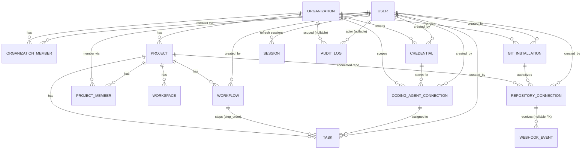
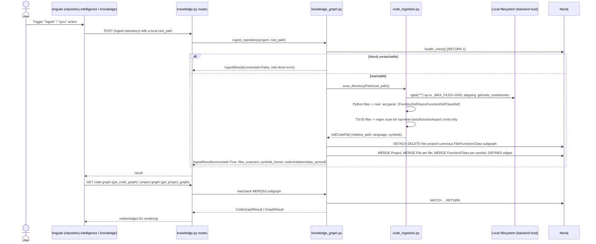

# Software Factory — Architecture As Implemented

Read-only audit. Every claim below is traced to a file path (and, where relevant, a
function/class name) actually read in this repository. Items with no corresponding
code are marked **UNKNOWN / NOT VERIFIED** or placed in Section 6. This document does
not re-audit Neo4j graph/RAG internals in depth — a separate pass covers that; here
Neo4j is only located in the overall architecture.

---

## 1. Actual Running System (containers, ports, data flow)

Source: `docker-compose.yml` (root), `backend/app/main.py`, `backend/app/core/config.py`.

- 4 services: `postgres`, `neo4j`, `backend`, `frontend`. No message broker, no
  cache, no worker/queue container, no vector-DB container exist in compose.
- `backend` command is literally `alembic upgrade head && uvicorn app.main:app --host 0.0.0.0 --port 8000`
  — a single-process ASGI app, no separate worker process.
- Background work (task/workflow execution) runs as Python `threading.Thread`
  **inside the same uvicorn process** (`backend/app/services/task_execution.py:56`,
  `backend/app/services/workflow_execution.py:25`), not a separate worker/queue.
- `frontend` container serves a built Angular app on port 80 (mapped to host 4300),
  depends on `backend` being healthy.

```mermaid
flowchart TB
    subgraph Host["Host machine (docker-compose.yml)"]
        FE["frontend container<br/>Angular build, nginx :80<br/>host 4300:80"]
        BE["backend container<br/>FastAPI + Uvicorn :8000<br/>host 8020:8000<br/>(alembic upgrade head on boot)"]
        PG[("postgres:16-alpine<br/>host 5433:5432<br/>db: software_factory")]
        N4J[("neo4j:5-community<br/>host 7475:7474 (http)<br/>host 7688:7687 (bolt)")]
    end

    Browser["User browser"] -->|HTTP :4300| FE
    FE -->|REST /api/v1/* + WS<br/>(backend base URL, see NOTE)| BE
    BE -->|psycopg2, SF_DATABASE_URL| PG
    BE -->|bolt driver, SF_NEO4J_URI| N4J
    BE -->|subprocess: real `git` CLI| GitRemote["Real Git remote<br/>(GitHub, via GitHub App)"]
    BE -->|httpx, GitHub REST API| GitHubAPI["GitHub API<br/>(api.github.com)"]
    GitHubAPI -. "pull_request / check_suite<br/>webhooks" .-> BE

    classDef note fill:#fff3cd,stroke:#c99;
    Note["NOTE: backend's own threads execute tasks/workflows in-process.<br/>No Celery/RQ/Temporal worker, no broker, no vector DB container exist."]:::note
```

Within the backend process, every incoming request is routed through
`app/main.py`, which mounts these routers (all under `/api/v1`, see the
`include_router` calls):

| Router file | Prefix segment(s) it defines |
|---|---|
| `backend/app/api/routes/auth.py` | `/auth/...` |
| `backend/app/api/routes/organizations.py` | `/organizations/...` |
| `backend/app/api/routes/projects.py` | `/projects/...` |
| `backend/app/api/routes/agent_runtimes.py` | coding-agent connection endpoints |
| `backend/app/api/routes/tasks.py` | `/projects/{project_id}/tasks/...`, `/tasks/mine` |
| `backend/app/api/routes/workflows.py` | workflow endpoints (same step-execution pattern as tasks) |
| `backend/app/api/routes/presence.py` | `/projects/{project_id}/presence/ws` (WebSocket) |
| `backend/app/api/routes/knowledge.py` | Neo4j-backed knowledge graph endpoints |
| `backend/app/api/routes/dashboard.py` | dashboard aggregate endpoints |
| `backend/app/api/routes/git_integration.py` | GitHub App install/repo-connection/webhook endpoints |

Health check: `GET /api/v1/health` (`backend/app/main.py`), used both by the
Docker healthcheck and by `backend` → `frontend`'s `depends_on`.

**Streaming/async channels found in code** (not aspirational — grepped and read):
- WebSocket: `backend/app/api/routes/presence.py` (`@router.websocket("/projects/{project_id}/presence/ws")`),
  backed by the in-memory `PresenceManager` in `backend/app/services/presence.py`
  (explicitly documented there as **single-process, no cross-replica fan-out**).
- Server-Sent Events via `StreamingResponse(..., media_type="text/event-stream")`:
  `backend/app/api/routes/tasks.py` (`stream_task`, line ~227) and
  `backend/app/api/routes/workflows.py` (equivalent `stream_task`-style endpoint,
  line ~241). Both poll the DB row every `_STREAM_POLL_SECONDS` (0.5s) up to
  `_STREAM_MAX_SECONDS` (600s) rather than being pushed to from the execution thread.
- No Celery, no `EventSource` consumption found server-side (frontend consumption of
  SSE was not separately verified — **NOT VERIFIED** on the Angular side beyond
  presence.service.ts using WebSocket).

---

## 2. Database Entity Relationships (actual SQLAlchemy models)

Source: every file in `backend/app/models/` (`__init__.py` lists the full exported
set) and `backend/alembic/versions/` (11 migrations, from `e327ef7ceec6_initial_schema.py`
through `d6f03b2c8a91_add_task_branch_protection_fields.py`, confirming the models match
an incrementally-grown schema, not a single big-bang design).



Notable real fields (not just entities) worth calling out because they encode actual
behavior, all on `backend/app/models/task.py`'s `Task`:
- `git_branch_name`, `git_base_branch`, `git_diff`, `git_changed_files` (Phase 14 comment)
- `git_pr_url`, `git_pr_number` (Phase 15), `git_pr_state` (Phase 16, synced only via webhook)
- `git_ci_status` (Phase 17, synced only via webhook)
- `git_base_branch_protected`, `git_required_status_checks`, `git_required_approving_reviews` (Phase 18, informational only — not enforced by this backend)
- `cancel_requested` (polled cooperative cancellation, not a hard kill)

`Workflow` (`backend/app/models/workflow.py`) has no FK *to* `Task`; instead `Task.workflow_id`
is a nullable FK *from* Task to Workflow, with `Task.step_order` providing ordering —
i.e., workflow steps are literally Task rows, confirmed by `workflow_execution.py`
querying `Task` filtered by `workflow_id` ordered by `step_order`.

---

## 3. Task Execution Data Flow (user submits task → ... → PR opened)

Source: `backend/app/api/routes/tasks.py` (`start_task`, `stream_task`),
`backend/app/services/task_execution.py` (`execute_task`, `_run`),
`backend/app/services/git_worktree.py` (`prepare_worktree`, `collect_diff`, `push_branch`),
`backend/app/services/git_provider/github_app.py` (via `get_git_provider`),
`backend/app/services/git_webhook.py` (`process_event`, for PR/CI state sync).

```mermaid
sequenceDiagram
    actor User
    participant FE as Angular (task-workspace)
    participant API as tasks.py (FastAPI)
    participant TX as task_execution.execute_task
    participant WT as git_worktree.py
    participant Adapter as agent_runtime adapter (registry.get_adapter)
    participant GH as git_provider (GitHubAppAdapter)
    participant DB as PostgreSQL

    User->>FE: Create + Start task
    FE->>API: POST /projects/{id}/tasks (create_task)
    API->>DB: INSERT Task (status=NOT_STARTED)
    FE->>API: POST /projects/{id}/tasks/{id}/start (start_task)
    API->>TX: start_task_in_background(task_id) [spawns daemon Thread]
    API-->>FE: 200 TaskResponse (status may still be NOT_STARTED/RUNNING)
    FE->>API: GET /projects/{id}/tasks/{id}/stream (SSE, polls DB every 0.5s)

    TX->>DB: task.started_at = now(); commit
    TX->>DB: load CodingAgentConnection + Credential (decrypt_value)
    TX->>Adapter: health_check(credential)
    alt not connected
        TX->>DB: status=FAILED, error_message; commit
    else connected
        TX->>DB: query RepositoryConnection (status=CONNECTED) for project
        opt repository connected
            TX->>WT: prepare_worktree(task, connection)
            WT->>GH: get_authenticated_clone_url(installation, owner, repo)
            WT->>WT: real `git clone --branch <default> --depth 1`
            WT->>WT: real `git checkout -b sf-task-<id>`
            WT-->>TX: WorktreeResult(path, branch_name, base_branch, clone_secret)
            TX->>DB: task.git_branch_name/git_base_branch; commit
        end
        TX->>Adapter: start_execution_streaming(prompt, credential, on_chunk, should_cancel, cwd=worktree.path)
        loop streamed output
            Adapter-->>TX: chunk
            TX->>DB: task.output += chunk (commit every 20 chunks)
            TX->>DB: should_cancel() checks task.cancel_requested
        end
        Adapter-->>TX: ExecutionResult(succeeded, output/error)
        TX->>DB: status=COMPLETED|FAILED; completed_at; commit
        opt worktree existed
            TX->>WT: collect_diff(path, task.title) [git add -A; commit if dirty; git diff HEAD~1 HEAD]
            TX->>DB: git_diff, git_changed_files; commit
            opt diff has changed_files and repo connected
                TX->>WT: push_branch(path, branch_name, clone_secret)
                TX->>GH: create_pull_request(installation, owner, repo, branch, base, title, description)
                GH-->>TX: PR(url, number, state="open")
                TX->>DB: git_pr_url, git_pr_number, git_pr_state="open"; commit
                TX->>GH: get_branch_protection(installation, owner, repo, base_branch)
                GH-->>TX: protection rules (informational)
                TX->>DB: git_base_branch_protected, required_status_checks, required_approving_reviews
            end
        end
    end

    Note over GH,DB: Later, independently: GitHub sends pull_request / check_suite<br/>webhooks → git_integration.py route → git_webhook.process_event()<br/>updates Task.git_pr_state / Task.git_ci_status. Never polled from task_execution.py.
    API-->>FE: SSE stream ends when task reaches COMPLETED/FAILED or 600s timeout
```

Key honesty properties actually coded (per in-file comments and logic, verified by
reading, not assumed): a task is marked `COMPLETED` only when `result.succeeded is True`
from a real adapter call; PR open/branch-protection failures never overturn the task's
own success/failure verdict (`task_execution.py` lines ~201-208); credentials are
redacted from worktree error text (`git_worktree.py:_sanitize`).

---

## 4. Agent Execution Sequence (as actually coded)

Source: `backend/app/services/agent_runtime/registry.py`, `backend/app/services/agent_runtime/base.py`,
`backend/app/services/agent_runtime/adapters.py` (not read in full line detail beyond
imports/registry here — class names confirmed: `ClaudeCodeAdapter`, `CodexAdapter`,
`GeminiCliAdapter`, `QwenAdapter`, `DockerSandboxAdapter`, `CustomAdapter`).

```mermaid
sequenceDiagram
    participant TX as task_execution.execute_task
    participant Registry as agent_runtime.registry
    participant Adapter as CodingAgentRuntimeAdapter (one concrete adapter)
    participant CLI as Real local CLI process / provider API (per adapter)

    TX->>Registry: get_adapter(connection.runtime_slug)
    Registry-->>TX: concrete adapter instance (e.g. ClaudeCodeAdapter)
    TX->>Adapter: health_check(credential_value)
    Adapter->>CLI: real connectivity probe (adapter-specific; NOT independently re-verified per-adapter in this pass)
    CLI-->>Adapter: real status
    Adapter-->>TX: HealthResult(connected, detail)
    TX->>Adapter: start_execution_streaming(prompt, credential, on_chunk, should_cancel, cwd=worktree.path|None)
    Adapter->>CLI: invoke real CLI/provider call with cwd set to the task's worktree (or no cwd if no repo connection)
    loop while running
        CLI-->>Adapter: raw output
        Adapter->>TX: on_chunk(text) callback
        Adapter->>Adapter: should_cancel() checked between chunks
    end
    CLI-->>Adapter: process exit / final response
    Adapter-->>TX: ExecutionResult(succeeded, output, error)
```

**Not independently verified in this pass**: the exact mechanics inside each
adapter in `backend/app/services/agent_runtime/adapters.py` (e.g. whether
`ClaudeCodeAdapter` shells out to a local `claude` binary vs. calls an API,
and what `DockerSandboxAdapter`/`CustomAdapter` actually spawn) — the file's
full body was not read line-by-line in this audit; only its public class
names via the registry import were confirmed. Mark as **UNKNOWN / NOT VERIFIED**
pending a dedicated adapter-level read.

---

## 5. Repository Indexing Sequence — AS IT ACTUALLY EXISTS TODAY

Source: `backend/app/services/code_ingestion.py` (`scan_directory`, `_parse_python`,
`_parse_ts_js`), `backend/app/services/knowledge_graph.py` (`ingest_repository`,
`sync_project`, `get_code_graph`, `get_project_graph`), `backend/app/services/git_sync.py`
(`sync_repository_connection`), `backend/app/api/routes/knowledge.py` (not read in full
detail for its route signatures — inferred from service functions it must call).



**What this pipeline does NOT do today (explicit gaps, not aspirational drawing):**
- `ingest_repository` takes a **local filesystem path already on the backend host**
  (`root_path: str`) — there is no clone-from-remote-URL step in this module. The
  docstring in `code_ingestion.py` explicitly says this is deliberate (avoiding an
  SSRF/arbitrary-fetch vector), meaning indexing a connected GitHub repo's actual
  remote content is **not wired up to this ingestion path** — it is a separate,
  manual/local-path action distinct from the `RepositoryConnection`/`git_sync.py`
  mechanism used for tasks.
  `git_sync.py`'s `sync_repository_connection` only syncs **metadata** (default
  branch name, head commit SHA) — it does **not** call `code_ingestion` or write
  anything into Neo4j. There is no code path found that clones a `RepositoryConnection`'s
  real remote and feeds the clone into `ingest_repository`; that link is missing in code.
- No embeddings, no vector DB, no RAG/semantic retrieval step exists anywhere in
  `backend/app/services/` — Neo4j holds only structural File/Function/Class nodes
  and Project/Task/Workflow/User/Connection graph-of-activity nodes. No vector-DB
  container in `docker-compose.yml` and no vector client library in
  `backend/requirements.txt`.
- TS/JS symbol extraction is a regex ("not a full compiler", per the file's own
  docstring) — it can miss or misattribute non-trivial syntax (e.g. multi-line
  signatures, re-exports, namespaces).
- No incremental/diff-based re-ingestion: every `ingest_repository` call deletes
  and fully rebuilds that project's File/Function/Class subgraph from a fresh
  full directory scan (capped at 2000 files).

---

## 6. Planned but not implemented (docs/decision log vs. code)

Source: `Software_Factory_Architecture_Decision_Log (1).md` (phase roadmap, lines
~1861-1867, and architecture-stack table around line 73-76/132/383/389), cross-checked
against `backend/requirements.txt`, `backend/app/services/`, and `docker-compose.yml`.

| Documented/planned (decision log) | Found in code? | Evidence |
|---|---|---|
| **Temporal** — "durable workflow lifecycle, retries, timers," factory control plane | **No.** Not in `requirements.txt`, not in `docker-compose.yml`, no import anywhere in `backend/app` (grep for `temporal` only matched a `neo4j` internal module and files inside `backend/data/worktrees/...` — those are cloned *task-repo* source files, not this app's own code). | Workflow/task execution is plain Python `threading.Thread` (`task_execution.py`, `workflow_execution.py`), with cooperative polling-based cancellation — no durable execution, retries, or timers. |
| **LangGraph** — "agent reasoning," "supervisor coordinates specialized LangGraph subgraphs" | **No.** Not in `requirements.txt`, no import found. | The "Factory Supervisor" described in `workflow_execution.py`'s own docstring is literally a `for` loop over ordered `Task` rows in one thread — not a LangGraph graph of subgraphs. |
| Phase 2 "Agent Orchestration and Recovery" — execution contract, checkpoints, recoverable attempts | **Partial/No.** No checkpoint/resume model found; a failed task is just marked `FAILED` with no retry/resume mechanism found in `task_execution.py`. | — |
| Phase 3 "Parallel Engineering" — DAGs, scheduler, multi-user concurrency coordinator | **No.** Workflow steps run strictly sequentially (`for index, task in enumerate(steps)` in `workflow_execution.py`); no DAG structure, no scheduler service, no cross-task concurrency coordination code found. | — |
| Phase 4 "Repository and Engineering Intelligence" — Repository KG **and** Engineering KG, snapshots, controlled knowledge sharing | **Partial.** A structural code graph (File/Function/Class) exists (`knowledge_graph.py`), but no separate "Engineering KG," no snapshot/versioning mechanism, and (per Section 5 above) no link from a connected repository's real remote content into this graph. | — |
| Phase 5 "Quality, Verification and Governance" — independent QA/review, security checks, approval workflows, cost/observability dashboards | **Partial.** An `AuditLog` model and `audit.record(...)` calls exist (e.g. in `tasks.py`'s `create_task`). A `dashboard.py` service aggregates real counts. No independent QA/review agent, no automated security-check step, and no approval-workflow enforcement logic found in `backend/app/services/` (an `approvals` feature exists in the **frontend** — `frontend/src/app/features/approvals/` — but it is one of the 11 feature components wired to `core/mock-data.service.ts` rather than a real backend endpoint; see below). | — |
| Phase 6 "Production Readiness" — quotas, DR, deployment automation, enterprise controls | **No.** No quota enforcement, no backup/DR tooling, no deployment-automation code found in the repo. | — |
| Vector database / RAG / semantic search over code or docs | **No.** No vector-DB service in `docker-compose.yml`, no vector client in `requirements.txt`. | — |

**Frontend divergence worth flagging explicitly:** of the 17 top-level feature
components under `frontend/src/app/features/`, 11 import
`core/mock-data.service.ts` (`agents`, `approvals`, `artifacts`, `code-review`,
`knowledge`, `monitoring`, `project-workspace`, `prompts`, `providers`,
`repository-intelligence`, `settings`) rather than calling a real backend endpoint.
This was confirmed by a grep for `mock-data.service` imports, not by reading every
component in full — treat the exact proportion of mocked-vs-real behavior inside each
of those 11 components as **NOT FULLY VERIFIED** (some may mix mock and real calls),
but their dependency on the mock service is confirmed. The remaining feature
directories (`auth`, `dashboard`, `projects`, `task-workspace`, `workflows`) were not
grepped for the same pattern in this pass — **NOT VERIFIED** either way.

---

## Files read for this audit (for traceability)

`docker-compose.yml`; `backend/app/main.py`; `backend/app/core/config.py`;
`backend/app/core/database.py`; `backend/app/models/*.py` (all 10 files);
`backend/alembic/versions/` (listing only, not full diffs);
`backend/app/services/task_execution.py`; `backend/app/services/workflow_execution.py`;
`backend/app/services/code_ingestion.py`; `backend/app/services/git_sync.py`;
`backend/app/services/knowledge_graph.py`; `backend/app/services/git_worktree.py`;
`backend/app/services/agent_runtime/registry.py` (not `adapters.py` body);
`backend/app/services/git_provider/registry.py`;
`backend/app/services/access.py`, `audit.py`, `dashboard.py`, `git_webhook.py`,
`presence.py`, `slugify.py` (headers only); `backend/app/api/routes/tasks.py`;
`backend/app/api/routes/presence.py` (grep context); `backend/requirements.txt`;
`Software_Factory_Architecture_Decision_Log (1).md` (phase roadmap + stack sections);
`frontend/src/app/` top-level listing (`core/`, `features/`, `shared/`) and a grep
for `mock-data.service` usage.
