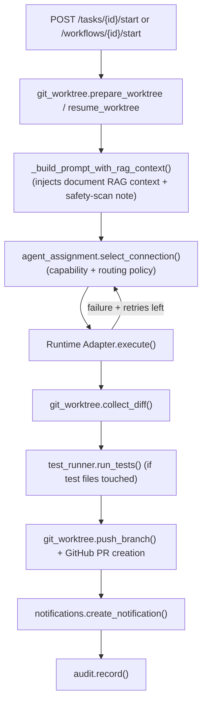
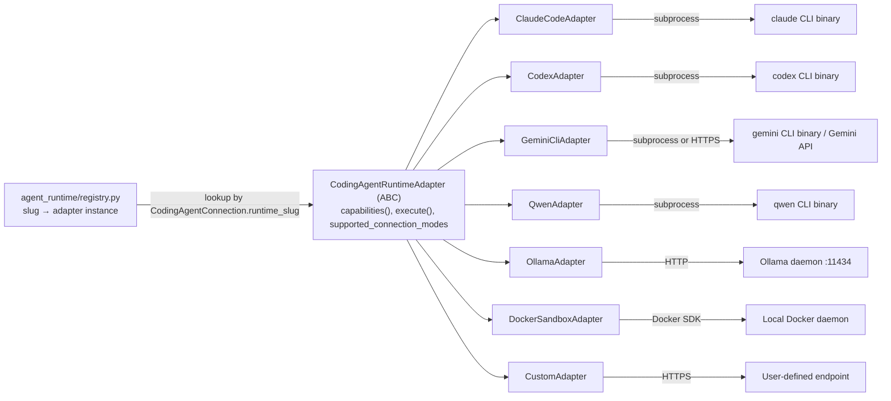
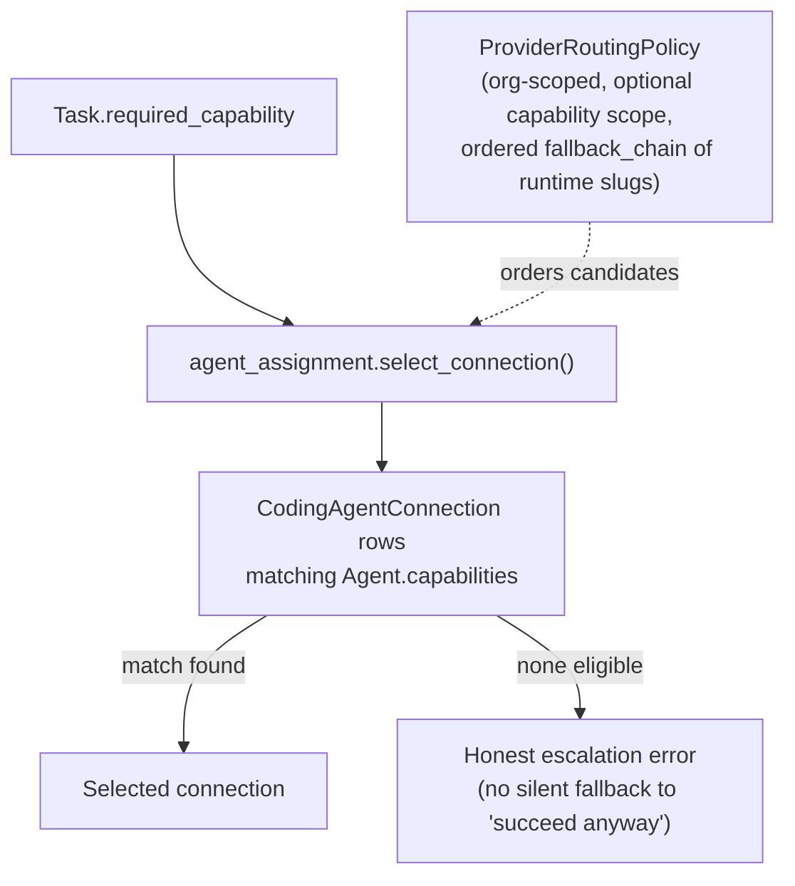
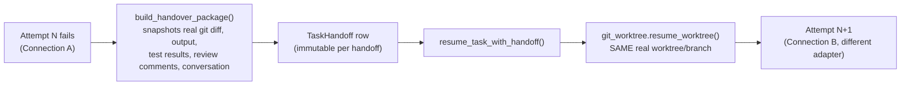
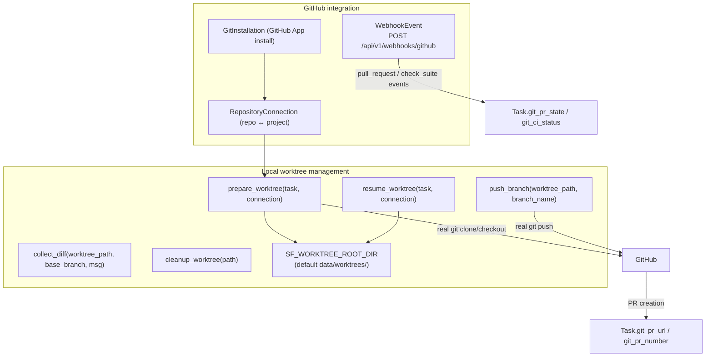
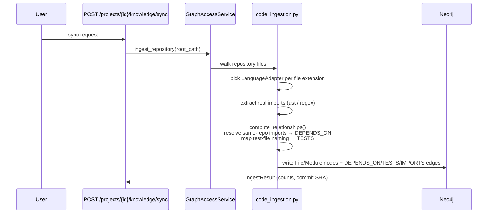
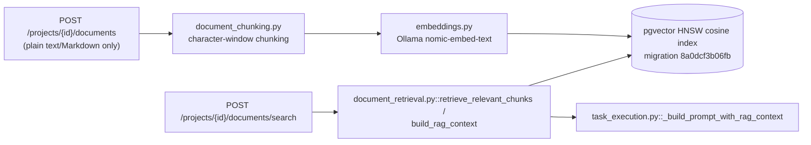
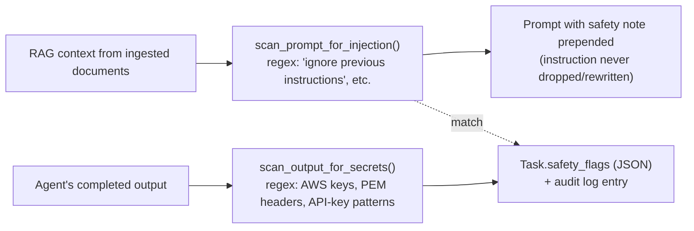
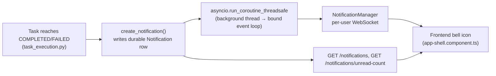
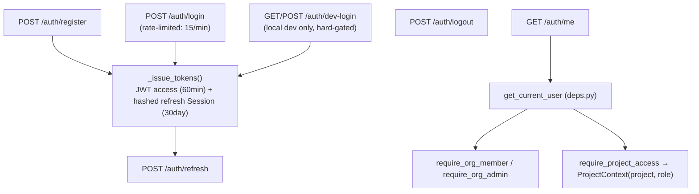

# Component Architecture

[← Back to README](../../README.md)

Every major component discovered in the repository, documented individually. Status labels
(**Implemented** / **Partial** / **Planned** / **Mock**) are derived from reading the actual source,
cross-checked against [`IMPLEMENTATION_STATE.md`](../../IMPLEMENTATION_STATE.md).

## Contents

- [Task & Workflow Execution Engine](#task--workflow-execution-engine)
- [Agent Runtime Adapters](#agent-runtime-adapters)
- [Agent Registry & Capability Assignment](#agent-registry--capability-assignment)
- [Resumable Handoff](#resumable-handoff)
- [Git Integration & Worktree Management](#git-integration--worktree-management)
- [Knowledge Graph / Graph Access Service](#knowledge-graph--repository-intelligence)
- [Repository Intelligence](#repository-intelligence)
- [RAG / Document Knowledge Pipeline](#rag--document-knowledge-pipeline)
- [Test Execution](#test-execution)
- [Safety Scanning](#safety-scanning)
- [Notifications](#notifications)
- [Audit Log](#audit-log)
- [Cost Tracking & Execution Tracing](#cost-tracking--execution-tracing)
- [Auth & RBAC](#auth--rbac)
- [Frontend — Project Workspace](#frontend--project-workspace)
- [Frontend — Prompt Registry (Mock)](#frontend--prompt-registry-mock)
- [API Surface by Router](#api-surface-by-router)

---

## Task & Workflow Execution Engine

**Overview.** The core of the platform: turns a `Task` or `Workflow` row into real work against a
real git worktree via a real agent runtime adapter. Files: [`task_execution.py`](../../backend/app/services/task_execution.py),
[`workflow_execution.py`](../../backend/app/services/workflow_execution.py).

**Internal architecture.**



For a `Workflow`, `workflow_execution.py` wraps this per-step in a round-based scheduler: a step is
"ready" once its `depends_on_step_orders` set (or, if unset, every prior step) is `COMPLETED`. Ready
steps in the same round run as separate Python threads, each with its own SQLAlchemy session.

**Responsibilities.** Status transitions (`not_started → running → completed/failed`), cancellation
(`cancel_requested` flag checked between phases), diff collection, PR creation, dependency-aware
scheduling, automatic retry-with-fallback.

**Interactions.** Called by `api/routes/tasks.py` and `api/routes/workflows.py`. Calls `git_worktree`,
`agent_assignment`, `agent_runtime` adapters, `test_runner`, `safety`, `notifications`, `audit`,
`knowledge_context` (for repository context injection).

**Technology.** Pure Python, SQLAlchemy ORM, `threading` for concurrency (no external task queue).

**Implementation status: Implemented.** Dependency-aware scheduling, real parallel execution,
capability-based assignment, and shared-context injection are all covered by
`tests/test_orchestration.py`, including a genuine multi-thread barrier-rendezvous test proving true
concurrency.

---

## Agent Runtime Adapters

**Overview.** A common interface (`CodingAgentRuntimeAdapter`, [`agent_runtime/base.py`](../../backend/app/services/agent_runtime/base.py))
with 7 concrete implementations in [`agent_runtime/adapters.py`](../../backend/app/services/agent_runtime/adapters.py).

| Adapter | Connection mode | Mechanism |
|---|---|---|
| `ClaudeCodeAdapter` | local CLI | subprocess: Claude Code CLI |
| `CodexAdapter` | local CLI | subprocess: Codex CLI |
| `GeminiCliAdapter` | local CLI / API | subprocess CLI, or hosted Gemini API with `SF_GEMINI_API_KEY` |
| `QwenAdapter` | local CLI | subprocess: Qwen CLI |
| `OllamaAdapter` | local HTTP | `POST http://.../api/generate`; only adapter that reports real token/duration usage |
| `DockerSandboxAdapter` | local Docker | Runs the prompt as a shell command inside a network-disabled, resource-limited container |
| `CustomAdapter` | HTTP | User-configured endpoint for a bring-your-own backend |

**Internal architecture.**



**Responsibilities.** Each adapter: reports its `capabilities()` (for capability-based assignment),
executes a prompt against a working directory, streams output where possible (`/tasks/{id}/stream`
SSE), returns an `ExecutionResult` (diff-relevant output, `usage` dict, success/failure).

**Interactions.** Instantiated via `registry.py` from a `CodingAgentConnection` row's `runtime_slug`.
Invoked exclusively by `task_execution.py`.

**Technology.** Python `subprocess` for CLI adapters, `httpx`/`requests`-style HTTP calls for Ollama/
Custom/hosted-Gemini, Docker SDK for the sandbox adapter.

**Configuration.** Optional per-CLI Docker sandboxing via `SF_CLAUDE_CODE_SANDBOX_IMAGE`,
`SF_CODEX_SANDBOX_IMAGE`, `SF_GEMINI_CLI_SANDBOX_IMAGE`, `SF_QWEN_SANDBOX_IMAGE` — all empty by
default, meaning these 4 adapters run directly on the backend host today.

**Implementation status: Implemented** (direct-host execution for all 7); **Partial** for CLI
sandboxing specifically — plumbing and Docker verification exist (`tests/test_cli_sandboxing.py`) but
ships disabled since no production sandbox image has been built per-CLI yet.

---

## Agent Registry & Capability Assignment

**Overview.** `Agent` ([`models/agent.py`](../../backend/app/models/agent.py)) is a registry of
named agent "roles" with declared capabilities, distinct from a `CodingAgentConnection` (a configured,
credentialed instance of a runtime adapter). [`agent_assignment.py`](../../backend/app/services/agent_assignment.py)
matches a `Task.required_capability` against registered agents/connections, consulting
`ProviderRoutingPolicy` for ordering when one exists for the organization (optionally scoped to a
specific capability).

**Internal architecture.**



**Responsibilities.** Resolve "who should run this step" deterministically and auditably; never
silently proceed with an unsuitable connection.

**Interactions.** Called by `task_execution.py` and `workflow_execution.py`. Reads `Agent`,
`CodingAgentConnection`, `ProviderRoutingPolicy`.

**API.** `POST`/`GET`/`DELETE /organizations/{id}/routing-policies` (org-admin write access).

**Implementation status: Implemented.** `tests/test_orchestration.py::test_routing_policy_orders_the_fallback_chain`,
`test_non_org_admin_cannot_create_routing_policy`. Explicitly out of scope: cost-based routing,
continuous provider health/circuit-breaking, versioned/pinned model profiles.

---

## Resumable Handoff

**Overview.** [`handoff.py`](../../backend/app/services/handoff.py) and
[`models/orchestration.py::TaskHandoff`/`TaskExecutionAttempt`](../../backend/app/models/orchestration.py)
let a task be handed from one agent connection to another — either a human-triggered handoff
(`POST /tasks/{id}/handoff`) or an automatic one (a failed step with `max_retries` set).

**Internal architecture.**



**Key honesty constraint.** No adapter today exposes a real provider-native resumable session ID —
every CLI/API invocation is a fresh process or call. `TaskHandoff.package["provider_session_id"]` is
therefore always `null`, documented in code as the deliberate "context-based continuation" fallback,
not native session resume.

**Interactions.** `POST /projects/{id}/tasks/{id}/handoff`, `GET .../handoffs`, `GET .../attempts`.
Called automatically from `workflow_execution.py`'s retry path.

**Implementation status: Implemented, with documented limitation.** `tests/test_orchestration.py::test_human_triggered_handoff_resumes_the_real_worktree_with_a_different_agent`
exercises a real Claude Code → Codex handoff against a real git worktree.

---

## Git Integration & Worktree Management

**Overview.** Two halves: GitHub App integration ([`git_integration.py`](../../backend/app/api/routes/git_integration.py),
[`git_provider/`](../../backend/app/services/git_provider/), [`git_sync.py`](../../backend/app/services/git_sync.py),
[`git_webhook.py`](../../backend/app/services/git_webhook.py)) and local worktree management
([`git_worktree.py`](../../backend/app/services/git_worktree.py)).

**Internal architecture.**



**Responsibilities.** Real GitHub App installation flow, repository connection, branch listing/
creation, PR creation, webhook-driven sync of PR/CI state (never inferred locally), and the actual
on-disk git worktree a task's agent executes inside.

**Technology.** `subprocess` calls to the host `git` binary; GitHub REST API via the installation
token flow.

**Implementation status: Implemented.**

---

## Knowledge Graph & Repository Intelligence

**Overview.** [`knowledge_graph.py`](../../backend/app/services/knowledge_graph.py) and
[`graph_access.py`](../../backend/app/services/graph_access.py) own all Neo4j interaction.
`GraphAccessService` is the **mandatory** entry point — constructed only from an already-authorized
`ProjectContext` (HTTP routes) or a trusted server-internal `Project` row (background execution);
no method on it accepts a caller-supplied project id.

**Internal architecture.**

```mermaid
flowchart TB
    Route["api/routes/knowledge.py"]
    Ctx["ProjectContext (RBAC-resolved)"]
    GAS["GraphAccessService.from_project_context(ctx)"]
    KG["knowledge_graph.py<br/>Cypher queries"]
    Ingest["code_ingestion.py<br/>LanguageAdapter framework"]
    PyAdapter["PythonAdapter<br/>(ast.Import/ImportFrom)"]
    TsAdapter["TypeScriptJavaScriptAdapter<br/>(regex-based import extraction)"]
    Neo[("Neo4j")]

    Route --> Ctx --> GAS --> KG --> Neo
    Ingest --> PyAdapter
    Ingest --> TsAdapter
    PyAdapter -->|files, DEPENDS_ON, TESTS edges| KG
    TsAdapter -->|files, DEPENDS_ON, TESTS edges| KG
    KG -->|_git_head_sha()| GitCommit["real git commit SHA tagged on ingest"]
```

**Repository ingestion flow.**



**Responsibilities.** Project entity graph (orgs/projects/tasks synced as nodes), repository code
graph (files, imports, dependency and test-mapping edges), schema/constraint setup at startup
(`ensure_schema()`, no-ops honestly if Neo4j is unreachable rather than blocking API startup).

**Scope note.** `CALLS` (call-graph) edges and endpoint/DB-model extraction are deliberately out of
scope per the project's own roadmap sequencing — not built.

**Interactions.** Read by `api/routes/knowledge.py` (`GET .../knowledge/graph`, `GET .../code-graph`)
and by `knowledge_context.py` for automatic context injection into task prompts.

**Implementation status: Implemented** for file/import/dependency/test-mapping extraction on Python
and TypeScript/JavaScript; **not implemented** for call-graph or DB-schema extraction.

---

## Repository Intelligence

**Overview.** [`repository_intelligence.py`](../../backend/app/api/routes/repository_intelligence.py)
(route), [`repository_intelligence_service.py`](../../backend/app/services/repository_intelligence_service.py),
[`graphify_adapter.py`](../../backend/app/services/graphify_adapter.py), and models in
[`models/repository_intelligence.py`](../../backend/app/models/repository_intelligence.py)
(`RepositoryIntelligenceSetting`, `RepositoryIndexingRun`). This module originated as pre-existing
uncommitted work in the main checkout and was later integrated into the committed backend.

**Responsibilities.** Repository indexing run tracking (status, metrics), settings per project, a
dedicated graphify adapter path distinct from the core `code_ingestion.py` pipeline.

**Frontend.** `repository-intelligence.component.ts` — real API-backed per the route list, though
parts of its UI historically overlapped with `knowledge-graph.component.ts`'s mock-data state; verify
current wiring in source before treating any specific panel as fully live.

**Implementation status: Implemented** (backend routes exist and are mounted); frontend wiring
completeness should be spot-checked per panel rather than assumed uniform.

---

## RAG / Document Knowledge Pipeline

**Overview.** [`document_chunking.py`](../../backend/app/services/document_chunking.py),
[`embeddings.py`](../../backend/app/services/embeddings.py),
[`document_retrieval.py`](../../backend/app/services/document_retrieval.py), models
`Document`/`DocumentChunk` ([`models/document.py`](../../backend/app/models/document.py)).

**Internal architecture.**



**Responsibilities.** Ingest text documents, chunk, embed via a real local Ollama call, store in
pgvector, retrieve by cosine similarity, inject the retrieved context (with a safety-scan pass, see
below) into a task's prompt.

**Scope note.** No PDF/DOCX/HTML parsing; no reranking step. Frontend consumers
(`knowledge-graph.component.ts`, `repository-intelligence.component.ts`) were **not** wired to these
real endpoints as of Phase 4 — verify current state before claiming a UI surface for this pipeline.

**Implementation status: Implemented (backend)**, verified live via curl (real ingest → embed →
retrieve with a genuine similarity score). No dedicated frontend UI confirmed wired.

---

## Test Execution

**Overview.** [`test_runner.py`](../../backend/app/services/test_runner.py) +
[`test_execution.py`](../../backend/app/services/test_execution.py), model
[`models/test_run.py`](../../backend/app/models/test_run.py).

**Responsibilities.** `detect_framework()` picks pytest or npm based on worktree contents,
`run_tests()` executes the real test command inside the task's actual worktree and parses pass/fail
counts from real output (`_parse_pytest_summary`). Results persist as `TestRun` rows.

**Interactions.** Invoked from `task_execution.py` after a task's agent run. `GET .../tasks/{id}/test-runs`.

**Implementation status: Implemented.** Verified live including a genuine Windows `npm.cmd` failure
case — i.e. failures are real subprocess failures, not simulated.

---

## Safety Scanning

**Overview.** [`safety.py`](../../backend/app/services/safety.py) — heuristic, regex-based, not an
LLM judge.

**Internal architecture.**



**Key honesty constraint.** A flagged output is never altered or redacted — the project's standing
rule against rewriting a real result applies to safety findings too. The matched secret value itself
is withheld from the finding's detail text, but the output stays as the agent actually produced it.

**Implementation status: Implemented** (heuristic only). Explicitly not built: LLM-judge scanning,
automatic redaction.

---

## Notifications

**Overview.** [`notifications.py`](../../backend/app/services/notifications.py) (service),
[`models/notification.py`](../../backend/app/models/notification.py), route
[`api/routes/notifications.py`](../../backend/app/api/routes/notifications.py).

**Internal architecture.**



**Responsibilities.** Durable notification row per genuine event (never a placeholder feed),
best-effort live delivery over WebSocket (a delivery failure never overturns the task's own real
result), poll-based fallback.

**Implementation status: Implemented.**

---

## Audit Log

**Overview.** Write path: [`audit.py`](../../backend/app/services/audit.py)'s `record()`, called from
7+ route modules. Read path: [`api/routes/audit_log.py`](../../backend/app/api/routes/audit_log.py)
(`GET /organizations/{id}/audit-logs`, org-member access, filterable by action/target type, paginated)
— added later; the write path existed well before any read surface did.

**Frontend.** `frontend/src/app/features/audit-log/` — a real table over real rows; writing is never
exposed through the UI.

**Implementation status: Implemented.**

---

## Cost Tracking & Execution Tracing

**Overview.** [`models/orchestration.py::TaskExecutionSpan`](../../backend/app/models/orchestration.py),
`TaskExecutionAttempt.usage` (JSON column on [`agent_runtime/base.py::ExecutionResult`](../../backend/app/services/agent_runtime/base.py)).

**Honesty constraint on usage data.** Of the 7 adapters, only `OllamaAdapter` reports real token/
duration usage (its `/api/generate` final streamed chunk includes `prompt_eval_count`/`eval_count`/
duration). Every local-CLI adapter wraps a bare subprocess with no token-accounting API — their
`usage` stays an empty `{}`, never estimated or fabricated.

**Tracing.** `TaskExecutionSpan` — one row per real phase already being executed (`adapter_execution`,
`diff_collection`, `pr_push`, `test_execution`), timed around genuinely-happening work, never a
synthetic duration.

**API.** `GET /projects/{id}/tasks/{id}/spans`, usage surfaced on `GET .../attempts`.

**Implementation status: Implemented, with honestly partial data coverage** (usage only for Ollama).

---

## Auth & RBAC

**Overview.** [`core/security.py`](../../backend/app/core/security.py) (JWT + password hashing),
[`core/rate_limit.py`](../../backend/app/core/rate_limit.py), [`api/deps.py`](../../backend/app/api/deps.py)
(RBAC resolution), [`api/routes/auth.py`](../../backend/app/api/routes/auth.py).

**Internal architecture.**



**RBAC model.** Two role scopes: `OrgRole` (organization-level, e.g. admin) and `ProjectRole`
(project-level membership role). `ProjectContext.require_role(allowed)` is the enforcement point used
throughout route handlers.

**Dev-login gate.** `SF_DEV_QUICK_LOGIN_ENABLED` + `SF_DEV_QUICK_LOGIN_EMAIL` must both be set; the
route 404s otherwise, and `_validate_non_local_settings()` in `core/config.py` refuses to even start
the process with dev-login enabled outside `SF_ENVIRONMENT=development/local/dev`.

**Implementation status: Implemented**, including fail-fast production-safety checks
(`tests/test_config_security.py`, `tests/test_auth.py`).

---

## Frontend — Project Workspace

**Overview.** [`project-workspace.component.ts`](../../frontend/src/app/features/project-workspace/project-workspace.component.ts)
is the largest feature component — tabs for Overview, Tasks, Workflows, Agents, Knowledge, Artifacts,
Activity, Settings within one project.

**Real vs. mock per tab:**

| Tab | Backing |
|---|---|
| Overview | Real (`project.service.ts`) |
| Tasks | Real (`task.service.ts`) — create, start, cancel, diff view, prompt-template picker (client-side only) |
| Workflows | Real (`workflow.service.ts`) |
| Agents | **Mock** (`MockDataService.agents`) |
| Knowledge | Real (`knowledge.service.ts`) |
| Artifacts | **Mock** (`MockDataService` via `artifacts.component.ts` when navigated standalone; in-tab rendering should be spot-checked) |
| Activity | **Mock** (`MockDataService.recentActivity`) |
| Settings | Real repository connection management (`git-integration.service.ts`) |

**Implementation status: Mixed — documented per-tab above rather than as one blanket status.**

---

## Frontend — Prompt Registry (Mock)

**Overview.** [`prompts.component.ts`](../../frontend/src/app/features/prompts/prompts.component.ts) /
`.html`. Entirely backed by `MockDataService.prompts` — a static signal of 6 hardcoded
`PromptVersion` objects (each now with its own distinct body text, previously all 6 shared one
placeholder string). No backend model, no API route, no persistence.

**What's real about it.** The New Task dialog in `project-workspace.component.ts` has a "Prompt
template (optional)" `<select>` that, on selection, copies the chosen mock prompt's `body` string
into the task's description field client-side (`applyPromptTemplate()`), substituting
`{{project_name}}`/`{{repository}}` placeholders with the real current project's values. This is a
UI convenience only — it does not read from or write to any prompt-specific backend state.

**Implementation status: Mock.** See [README → Development Roadmap](../../README.md#development-roadmap)
for what a real implementation would require.

---

## API Surface by Router

| Router | Base path | Key endpoints |
|---|---|---|
| `auth` | `/api/v1/auth` | `POST /register`, `POST /login`, `POST /refresh`, `POST /logout`, `GET/POST /dev-login`, `GET /me` |
| `organizations` | `/api/v1/organizations` | `POST ""`, `GET ""`, `GET /{id}`, `GET /{id}/members`, `POST/PATCH/DELETE /{id}/members/{member_id}` |
| `projects` | `/api/v1/projects` | `POST ""`, `GET ""`, `GET/PATCH /{id}`, `GET/POST /{id}/members`, `GET/POST /{id}/workspaces` |
| `agent_runtimes` | `/api/v1` | `GET /coding-agent-runtimes`, `GET /agents`, connection CRUD |
| `tasks` | `/api/v1` | `GET /tasks/mine`, `POST /projects/{id}/tasks`, `.../start`, `.../cancel`, `.../diff`, `.../messages`, `.../stream` (SSE), `.../test-runs` |
| `workflows` | `/api/v1` | `GET /workflows/mine`, `POST /projects/{id}/workflows`, `.../start`, `.../cancel`, `.../stream` |
| `presence` | — | WebSocket presence (who's viewing a project) |
| `knowledge` | `/api/v1/projects/{id}/knowledge` | `POST /sync`, `GET /graph`, `GET /code-graph` |
| `dashboard` | `/api/v1/dashboard` | `GET /summary` |
| `git_integration` | `/api/v1` | Installation, repository connection, branch, webhook endpoints |
| `approvals` | `/api/v1/projects/{id}/approvals` | `GET ""`, `POST ""`, `POST /{id}/decide` |
| `documents` | `/api/v1/projects/{id}/documents` | `GET ""`, `POST ""`, `DELETE /{id}`, `POST /search` |
| `orchestration` | `/api/v1` | Handoffs, execution attempts/spans, routing policies |
| `notifications` | `/api/v1/notifications` | `GET ""`, `GET /unread-count`, `POST /{id}/read`, `WS /ws` |
| `audit_log` | `/api/v1/organizations/{id}/audit-logs` | `GET ""` |
| `repository_intelligence` | `/api/v1` | Indexing run/settings endpoints |

Every route except `auth`'s public endpoints and the webhook receiver requires a valid JWT; most
project-scoped routes additionally require `require_project_access` with a sufficient `ProjectRole`.
