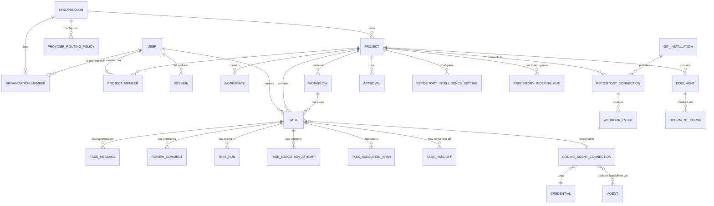
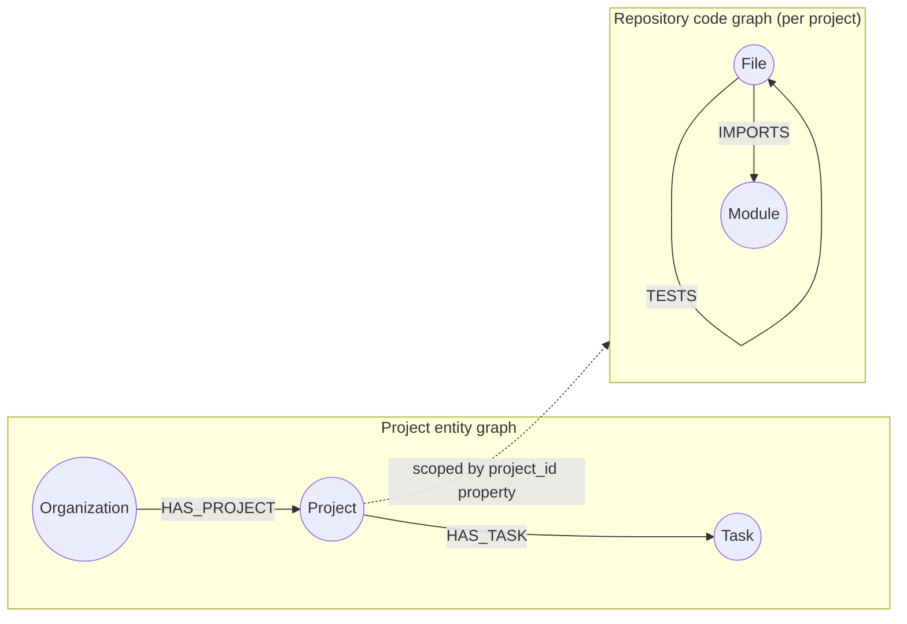
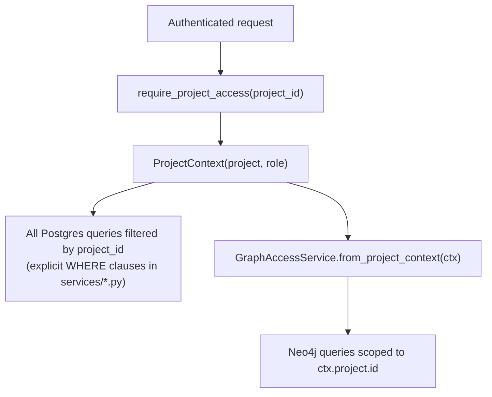

# Data Architecture

[← Back to README](../../README.md)

## Contents

- [Overview](#overview)
- [Relational Schema (PostgreSQL)](#relational-schema-postgresql)
- [Entity Relationship Diagram](#entity-relationship-diagram)
- [Knowledge Graph Schema (Neo4j)](#knowledge-graph-schema-neo4j)
- [Vector Storage (pgvector)](#vector-storage-pgvector)
- [Tenant & Project Isolation](#tenant--project-isolation)
- [File & Artifact Storage](#file--artifact-storage)
- [Migrations](#migrations)

## Overview

Software Factory uses three persistence mechanisms, each for a distinct purpose:

| Store | Technology | Holds |
|---|---|---|
| Relational | PostgreSQL 16 (`pgvector/pgvector:pg16`) | All platform entities: users, orgs, projects, tasks, workflows, documents, audit log, notifications |
| Graph | Neo4j 5 Community | Repository code structure (files, imports, dependency/test edges) and a mirrored project entity graph |
| Vectors | pgvector extension on the same Postgres instance | `DocumentChunk.embedding` — RAG retrieval, HNSW cosine index |
| Filesystem | Host disk, `SF_WORKTREE_ROOT_DIR` (default `data/worktrees/`) | Real git worktrees a task's agent executes inside |

There is no separate object store (e.g. S3) in this implementation — all structured data lives in
Postgres/Neo4j, and the only large binary-ish data (git repository contents) lives as real worktrees
on the backend host's filesystem.

## Relational Schema (PostgreSQL)

All models inherit `UUIDPrimaryKeyMixin` (UUID primary key) and `TimestampMixin`
(`created_at`/`updated_at`) from [`models/mixins.py`](../../backend/app/models/mixins.py).

| Model | File | Purpose |
|---|---|---|
| `User` | `models/user.py` | Account identity |
| `Session` | `models/session.py` | Hashed refresh tokens |
| `Organization`, `OrganizationMember` | `models/organization.py` | Tenant boundary, org-level RBAC |
| `Project`, `ProjectMember`, `Workspace` | `models/project.py` | Project-level RBAC, workspace grouping |
| `Task` | `models/task.py` | A unit of agent work — the largest model, ~30 columns spanning execution state, git integration (branch/diff/PR/CI), orchestration (capability, dependencies, retries), safety flags, knowledge context, model selection |
| `Workflow` | `models/workflow.py` | Ordered set of `Task` steps |
| `TaskMessage` | `models/task_message.py` | Multi-turn conversation per task |
| `ReviewComment` | `models/review_comment.py` | Code review comments on a task's diff |
| `Approval` | `models/approval.py` | Post-hoc approval gate on a task outcome |
| `TestRun` | `models/test_run.py` | Persisted real test execution results |
| `Agent` | `models/agent.py` | Capability-tagged agent registry entry |
| `Credential`, `CodingAgentConnection` | `models/agent_runtime.py` | Encrypted credentials + configured runtime connections |
| `GitInstallation`, `RepositoryConnection`, `WebhookEvent` | `models/git_integration.py` | GitHub App integration state |
| `Document`, `DocumentChunk` | `models/document.py` | RAG source documents + embedded chunks |
| `Notification` | `models/notification.py` | Durable per-user event notifications |
| `AuditLog` | `models/audit.py` | Append-only action record |
| `TaskExecutionAttempt`, `TaskExecutionSpan`, `TaskHandoff`, `ProviderRoutingPolicy` | `models/orchestration.py` | Per-invocation audit log, execution tracing, resumable handoff packages, provider fallback policy |
| `RepositoryIntelligenceSetting`, `RepositoryIndexingRun` | `models/repository_intelligence.py` | Repository indexing configuration and run history |

## Entity Relationship Diagram

Key `Task` columns beyond identity/timestamps (full list in
[`task.py`](../../backend/app/models/task.py)): `project_id`, `workflow_id`, `step_order`, `status`,
`priority`, `coding_agent_connection_id`, `created_by_user_id`, `required_capability`,
`depends_on_step_orders` (JSON), `max_retries`/`retry_count`, `safety_flags` (JSON),
`git_branch_name`/`git_base_branch`/`git_diff`/`git_changed_files`, `git_pr_url`/`git_pr_number`/
`git_pr_state`, `git_ci_status`, `git_base_branch_protected`/`git_required_status_checks`/
`git_required_approving_reviews`, `knowledge_context` (JSON), `selected_model`/`execution_runtime`/
`execution_history` (JSON).

## Knowledge Graph Schema (Neo4j)

- `DEPENDS_ON` — a real, resolved same-repository import between two files (computed in
  `code_ingestion.py::compute_relationships`).
- `TESTS` — a file recognized by naming convention as the test for another file.
- `IMPORTS` — an external or unresolved import, modeled as an edge to a `Module` node rather than
  dropped.
- Every node carries a `project_id` property; `GraphAccessService` is the only code path permitted to
  issue Cypher, and it always scopes by the `Project` it was constructed from — see
  [Security Architecture](security-architecture.md#tenant-isolation).
- Not modeled: call graphs (`CALLS` edges), database schema extraction — deliberately deferred per the
  project's roadmap sequencing.

## Vector Storage (pgvector)

`DocumentChunk.embedding` is a pgvector column with an HNSW cosine-distance index (migration
`8a0dcf3b06fb`). Embeddings come from a real local Ollama call (`nomic-embed-text` model) — no
external embedding API. Retrieval (`document_retrieval.py::retrieve_relevant_chunks`) runs a real
cosine-similarity query against this index, scoped to the requesting project's documents.

## Tenant & Project Isolation

Isolation is enforced at the service-call boundary, not by a generic row-level-security policy in
Postgres — every service function that reads/writes project-scoped data takes a `Project`/
`ProjectContext` derived from `require_project_access`, never a bare id read straight from a request
body.

## File & Artifact Storage

Task execution artifacts are **not** stored as uploaded blobs — they are the real, re-derivable state
of a git worktree on disk (`SF_WORKTREE_ROOT_DIR`) plus the `git_diff` text persisted on the `Task`
row itself. There is no dedicated binary-artifact storage service; "Artifacts" as a frontend concept
(`frontend/src/app/features/artifacts/`) is currently backed by `MockDataService`, not a real storage
backend — see [Component Architecture](component-architecture.md#frontend--project-workspace).

## Migrations

23 Alembic migrations as of this writing (`backend/alembic/versions/`), managed exclusively through
`alembic revision --autogenerate` + `alembic upgrade head` — see
[Installation & Setup](../../README.md#installation--setup). Notable migrations: `8a0dcf3b06fb` (RAG
pgvector/HNSW index), `64644fed887f` (orchestration columns on `tasks`: capability, dependencies,
retries), `d42e13a77792` (`safety_flags` column).
