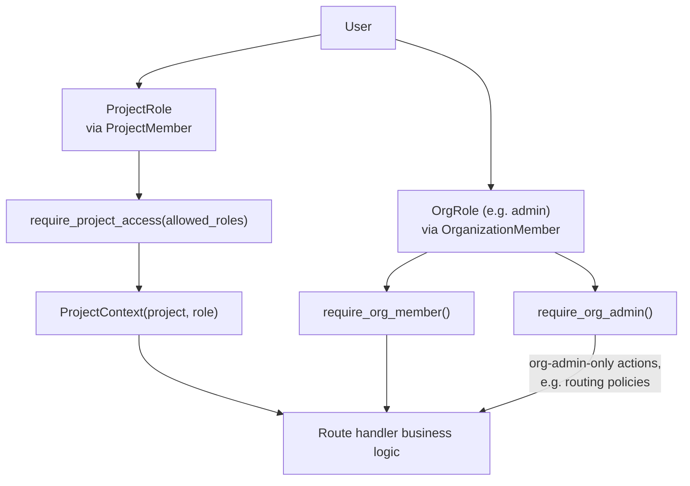
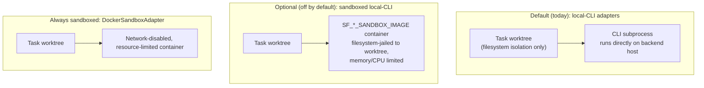

# Security Architecture

[← Back to README](../../README.md)

## Contents

- [Authentication](#authentication)
- [Authorization (RBAC)](#authorization-rbac)
- [Tenant Isolation](#tenant-isolation)
- [Credential Management](#credential-management)
- [Sandboxing](#sandboxing)
- [Prompt Injection & Output Secret Scanning](#prompt-injection--output-secret-scanning)
- [API Security](#api-security)
- [Auditability](#auditability)
- [Production Safety Checks](#production-safety-checks)
- [Known Gaps (Honest)](#known-gaps-honest)

## Authentication

JWT access tokens (60-minute expiry, `SF_JWT_SECRET`, HS256) plus a hashed refresh-token `Session`
row (30-day expiry) for renewal — [`core/security.py`](../../backend/app/core/security.py),
[`api/routes/auth.py`](../../backend/app/api/routes/auth.py). Passwords are hashed (`hash_password`/
`verify_password`), never stored in plaintext. Refresh tokens are stored hashed
(`hash_refresh_token`), not raw, so a database read alone cannot be replayed as a valid refresh token.

Login and registration are rate-limited (`core/rate_limit.py`: 15/min login, 8/min register) via a
sliding-window limiter keyed per-request, guarding against credential-stuffing/brute-force.

**Local-dev-only quick login.** A `GET`/`POST /auth/dev-login` path exists purely for local
development convenience (the "Quick sign in as X" button). It is gated by **two** independent
controls:
1. `SF_DEV_QUICK_LOGIN_ENABLED` must be explicitly `true` (default `false`) — the route 404s otherwise.
2. `Settings.is_local_dev` must be true (`SF_ENVIRONMENT` in `development`/`local`/`dev`) —
   `_validate_non_local_settings()` in `core/config.py` refuses to even **start the process** if
   dev-login is enabled while `SF_ENVIRONMENT` is set to anything else, alongside failing fast on
   placeholder `SF_JWT_SECRET`/`SF_CREDENTIAL_ENCRYPTION_KEY` values in that same non-local case.

## Authorization (RBAC)

Two independent role scopes — organization and project — resolved per-request in
[`api/deps.py`](../../backend/app/api/deps.py). `ProjectContext.require_role(allowed: set[ProjectRole])`
is the enforcement call sites use inline (e.g. "only `project_admin` can delete a task"). There is no
implicit "org admin bypasses project RBAC" shortcut visible in `deps.py` — project access is resolved
through actual `ProjectMember` rows.

## Tenant Isolation

Every project-scoped Postgres query filters explicitly by `project_id` derived from
`require_project_access`. Every Neo4j operation is mandatory-routed through
[`GraphAccessService`](../../backend/app/services/graph_access.py), which is constructable only from:
1. `GraphAccessService.from_project_context(ctx)` — an HTTP route's already-authorized `ProjectContext`.
2. `GraphAccessService.from_project(project)` — a trusted server-internal caller (e.g. a background
   execution thread) that already loaded `project` through its own authorization path (a `Task` row
   whose `project_id` was fixed at creation time under RBAC).

No method on `GraphAccessService` accepts a bare, caller-supplied project id — this closes a gap the
project's own architecture decision log flags explicitly: before this service existed, every Neo4j
caller passed its own choice of `project_id`, safe only because every caller happened to be careful,
not because anything enforced it.

## Credential Management

`Credential` ([`models/agent_runtime.py`](../../backend/app/models/agent_runtime.py)) stores
coding-agent provider credentials encrypted at rest using `SF_CREDENTIAL_ENCRYPTION_KEY`. This key
must be changed from its placeholder default outside local development — enforced by the same
`_validate_non_local_settings()` fail-fast check described above. GitHub App credentials
(`SF_GITHUB_APP_PRIVATE_KEY`, `SF_GITHUB_WEBHOOK_SECRET`) are supplied via environment variables, not
committed to the repository.

## Sandboxing

**Current real isolation boundary:** a task executes inside a real, dedicated git worktree
(filesystem isolation between tasks — each task gets its own working directory under
`data/worktrees/`), but the coding-agent **process** itself (Claude Code CLI, Codex CLI, Gemini CLI,
Qwen CLI) runs directly on the backend host, not inside a container, by default.

**What exists but is off by default:** per-CLI Docker sandboxing
(`app/services/agent_runtime/adapters.py::_run_cli_prompt_streaming_sandboxed`), gated by
`SF_CLAUDE_CODE_SANDBOX_IMAGE`/`SF_CODEX_SANDBOX_IMAGE`/`SF_GEMINI_CLI_SANDBOX_IMAGE`/
`SF_QWEN_SANDBOX_IMAGE`. All four are empty by default — meaning sandboxing has zero effect on
today's actual behavior until a real per-CLI Docker image is built and configured. The plumbing is
genuinely Docker-verified (`tests/test_cli_sandboxing.py`), it just isn't turned on.

**The one adapter that is always sandboxed:** `DockerSandboxAdapter` always runs inside a network-
disabled, resource-limited (memory/CPU) container, unconditionally — this is its entire purpose, not
an opt-in mode.

## Prompt Injection & Output Secret Scanning

See [Component Architecture → Safety Scanning](component-architecture.md#safety-scanning) for the
full mechanism. Summary: heuristic regex matching, not an LLM judge; injection patterns are scanned in
RAG-retrieved document context before it reaches an agent's prompt (with a safety note prepended, not
instruction removal); credential-shaped strings are scanned in an agent's completed output and
flagged — the output itself is never altered or redacted.

## API Security

- CORS is explicit allow-list (`SF_CORS_ORIGINS`), not a wildcard, in both local (`["http://localhost:4200"]`
  default) and Docker Compose (`["http://localhost:4200", "http://localhost:4300"]`) configurations.
- All mutating endpoints require a valid JWT via `get_current_user`, except registration/login
  themselves and the GitHub webhook receiver (which instead validates `SF_GITHUB_WEBHOOK_SECRET`'s
  HMAC signature — see `git_webhook.py`).
- Rate limiting is applied specifically to the two endpoints most valuable to brute-force
  (login, register) — not a blanket global rate limiter.

## Auditability

`AuditLog` ([`models/audit.py`](../../backend/app/models/audit.py)) is an append-only table written
from 7+ route/service call sites via `audit.record()`. It has a real read surface
(`GET /organizations/{id}/audit-logs`, org-member access, filterable, paginated) with no write path
exposed through that same API — the only way a row is created is as the honest side effect of a real
action elsewhere in the system, never a user-authored audit entry.

## Production Safety Checks

`core/config.py::_validate_non_local_settings()` runs at process startup (via `get_settings()`'s
`@lru_cache`'d call) and **refuses to start** the backend if, while `SF_ENVIRONMENT` is not
`development`/`local`/`dev`:
- `SF_JWT_SECRET` is still `"dev-secret-change-me"`, or
- `SF_CREDENTIAL_ENCRYPTION_KEY` is still `"dev-credential-key-change-me"`, or
- `SF_DEV_QUICK_LOGIN_ENABLED` is `true`.

This is a fail-fast design choice specifically to prevent a shared/production deployment from
silently running with insecure local-dev defaults — covered by `tests/test_config_security.py`.

## Known Gaps (Honest)

- Local-CLI adapter sandboxing is plumbing-only; no production sandbox image ships today.
- Safety scanning is regex-based, not semantic — it will miss injection/secret patterns that don't
  match its known phrasings, and (per its own design) can false-positive on legitimate text.
- No automated secret rotation; `SF_JWT_SECRET`/`SF_CREDENTIAL_ENCRYPTION_KEY` rotation is a manual
  operational step.
- No row-level security policy at the Postgres level — isolation relies on every service function
  correctly filtering by `project_id`/`organization_id`, enforced by code review and tests rather
  than a database-level guarantee.
