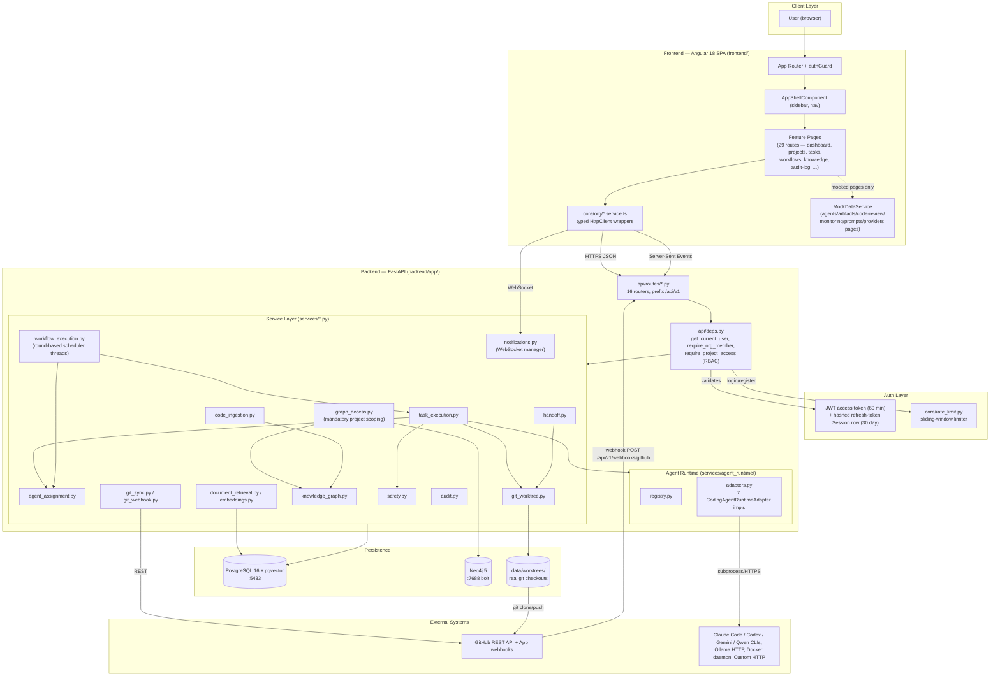
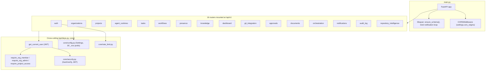
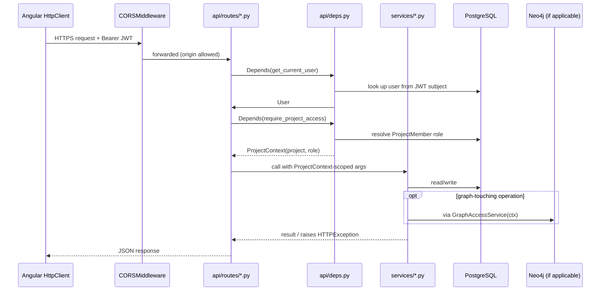
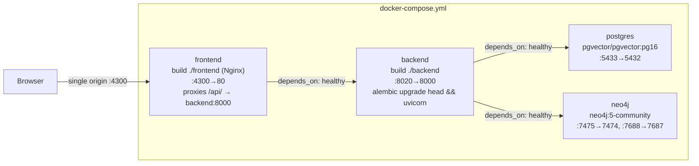

# System Architecture

[← Back to README](../../README.md)

## Contents

- [Overview](#overview)
- [Complete System Diagram](#complete-system-diagram)
- [Frontend Architecture](#frontend-architecture)
- [Backend Architecture](#backend-architecture)
- [Request Lifecycle](#request-lifecycle)
- [External Integrations](#external-integrations)
- [Deployment Topology](#deployment-topology)

## Overview

Software Factory has no separate API-gateway service — FastAPI itself (`backend/app/main.py`) is the
single backend entry point, all routes mounted under `/api/v1`. There is one Angular SPA, one FastAPI
process, one PostgreSQL instance, one Neo4j instance, and the host filesystem used for real git
worktrees. This is a deliberately simple topology; there is no message queue, no separate worker
process, and no API gateway — orchestration runs as background threads inside the FastAPI process
itself (`workflow_execution.py`, `task_execution.py` spawn `threading.Thread`s for concurrent step
execution, not a separate task queue like Celery).

## Complete System Diagram

## Frontend Architecture

```mermaid
flowchart LR
    subgraph App["Angular App (standalone components, signals)"]
        Main["main.ts bootstrap"]
        Routes["app.routes.ts<br/>29 lazy-loaded routes"]
        Guard["auth.guard.ts<br/>redirects to /login if no token"]
        Shell["AppShellComponent<br/>sidebar nav, org switcher"]

        subgraph RealFeatures["Features backed by real APIs"]
            Dashboard["dashboard"]
            Projects["projects / project-workspace"]
            Tasks["task-workspace"]
            Workflows["workflows"]
            Knowledge["knowledge (graph)"]
            RepoIntel["repository-intelligence"]
            AuditLog["audit-log"]
            CodeReviewReal["code-review (comments/diff)"]
            Approvals["approvals"]
        end

        subgraph MockFeatures["Features using MockDataService (partly or fully)"]
            Agents["agents"]
            Artifacts["artifacts"]
            Monitoring["monitoring"]
            Prompts["prompts"]
            Providers["providers"]
            Settings["settings"]
        end

        subgraph CoreServices["core/org/*.service.ts"]
            TaskSvc["task.service.ts"]
            WorkflowSvc["workflow.service.ts"]
            KnowledgeSvc["knowledge.service.ts"]
            GitSvc["git-integration.service.ts"]
            NotifSvc["notification.service.ts"]
            AuditSvc["audit-log.service.ts"]
        end
    end

    Main --> Routes --> Guard --> Shell
    Shell --> RealFeatures
    Shell --> MockFeatures
    RealFeatures --> CoreServices
    CoreServices -->|HttpClient| Backend[("FastAPI /api/v1")]
```

Every component under `core/org/` is a thin typed wrapper over `HttpClient` calling a real backend
endpoint. `MockDataService` (`frontend/src/app/core/mock-data.service.ts`) is a single injectable
holding static signals of placeholder data, consumed directly by: `agents`, `artifacts`, `code-review`
(stats only — comments themselves are real), `monitoring`, `prompts`, `providers`, `settings`, and a
narrow slice of `project-workspace` (its Agents tab and Recent Activity feed, and the New Task dialog's
prompt-template picker).

## Backend Architecture

## Request Lifecycle

## External Integrations

| System | Direction | Mechanism | Used for |
|---|---|---|---|
| GitHub | Outbound | REST API via GitHub App installation token | Repository listing, branch ops, PR creation (`git_provider/`, `git_integration.py`) |
| GitHub | Inbound | Webhook `POST /api/v1/webhooks/github` | `pull_request` and `check_suite` events keep `Task.git_pr_state`/`git_ci_status` in sync |
| Claude Code / Codex / Gemini CLI / Qwen | Outbound | Local subprocess (CLI installed on backend host) | Real coding-agent execution |
| Gemini (hosted) | Outbound | HTTPS API (`SF_GEMINI_API_KEY`) | Alternative to the Gemini CLI path |
| Ollama | Outbound | HTTP (`/api/generate`) | Local coding-agent execution + RAG embeddings (`nomic-embed-text`) |
| Docker daemon | Outbound | Docker SDK/CLI | `DockerSandboxAdapter` isolated execution; optional per-CLI sandbox images |
| Custom HTTP adapter | Outbound | User-configured HTTPS endpoint | Bring-your-own coding-agent backend |

## Deployment Topology

Local non-Docker development instead runs `ng serve` on `:4200` talking directly to `uvicorn` on
`:8010`, with Postgres still via `docker compose up -d postgres` on `:5433` and Neo4j likewise
containerized.
