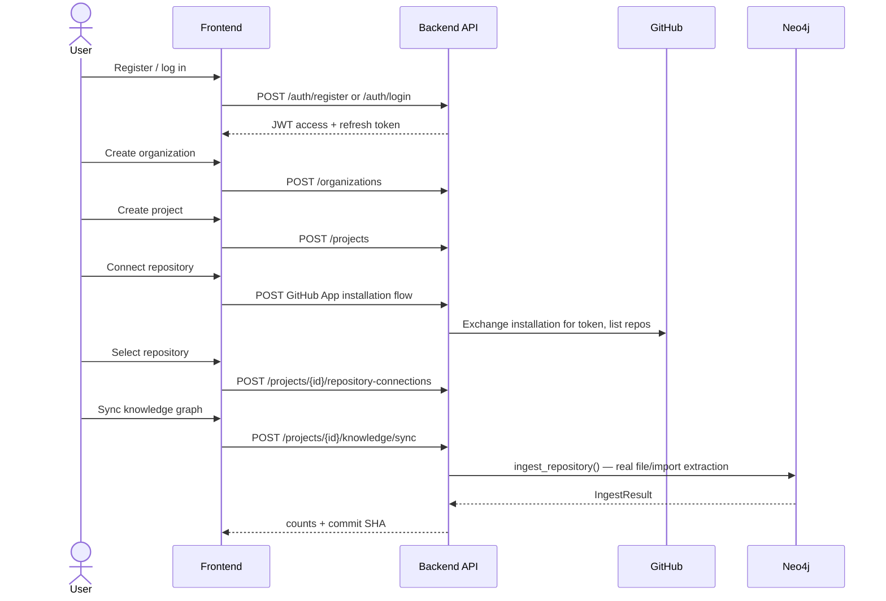
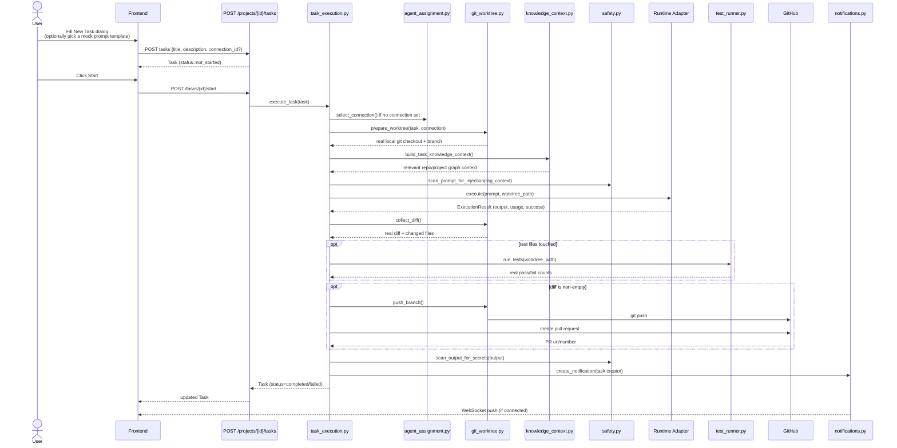
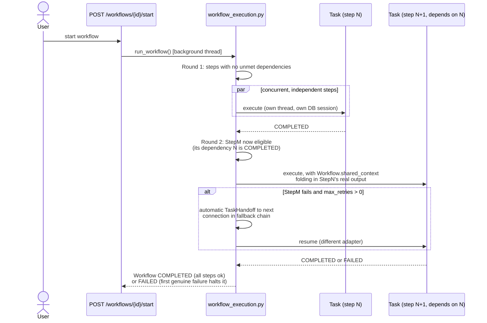
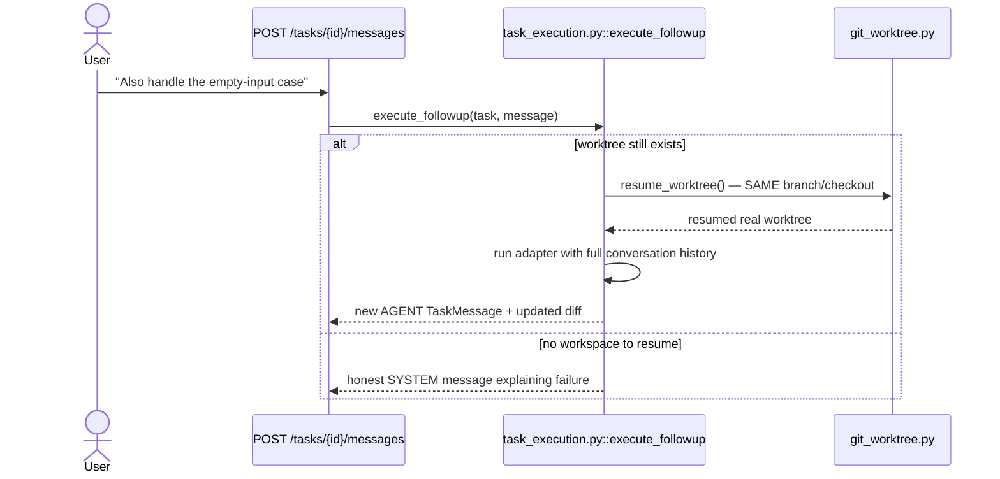
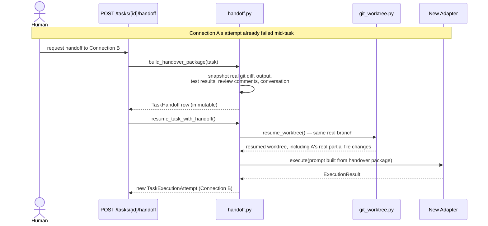
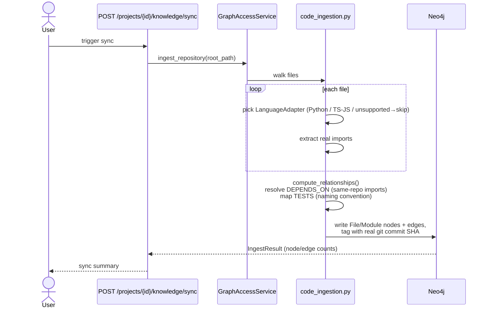
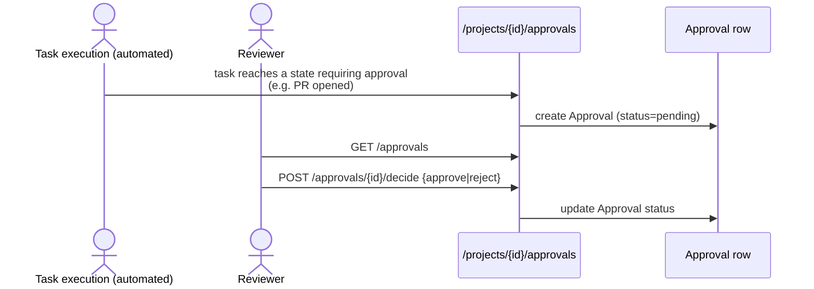

# End-to-End Workflows

[← Back to README](../../README.md)

## Contents

- [Project Onboarding](#project-onboarding)
- [Single Task: Create → Execute → PR](#single-task-create--execute--pr)
- [Multi-Step Workflow Execution](#multi-step-workflow-execution)
- [Follow-Up Conversation on a Running/Completed Task](#follow-up-conversation-on-a-runningcompleted-task)
- [Agent Handoff on Failure](#agent-handoff-on-failure)
- [Repository Knowledge Sync](#repository-knowledge-sync)
- [Approval Gate](#approval-gate)

## Project Onboarding

## Single Task: Create → Execute → PR

This is the platform's core loop — adapted from the actual implementation in
[`task_execution.py`](../../backend/app/services/task_execution.py), not an idealized flow.

**Honesty notes baked into this flow (from the actual code, not assumption):** if no coding-agent
connection is reachable, the task fails with an explicit error rather than reporting success; if the
diff is empty, no PR is opened; if the adapter provides no usage data (every adapter except Ollama),
`usage` stays `{}` rather than being estimated.

## Multi-Step Workflow Execution

A workflow using no `depends_on_step_orders` declarations runs byte-for-byte as a simple sequential
pipeline — this concurrency path is strictly additive, not a behavior change for workflows that don't
opt into it.

## Follow-Up Conversation on a Running/Completed Task

A follow-up while the task is already `running` is rejected with `409 Conflict` rather than racing a
second execution against the same worktree.

## Agent Handoff on Failure

## Repository Knowledge Sync

Incremental vs. full re-index: the ingestion walks and re-writes the current file set on each sync
call — there is no separate "full re-index" trigger distinct from "sync" in the current implementation;
a full re-index is simply running sync again, which recomputes relationships from the current file
state. Treat "incremental" language elsewhere as describing the per-file extraction granularity, not a
separate code path from full sync.

## Approval Gate

**Scope note:** this is a post-hoc approval of an already-opened PR, not a pre-execution planning gate
— there is no `Plan` entity or "approve before the agent runs" step in the current implementation,
despite that being part of the original product vision (see
[`IMPLEMENTATION_STATE.md`](../../IMPLEMENTATION_STATE.md) Phase 3, P3-6).
